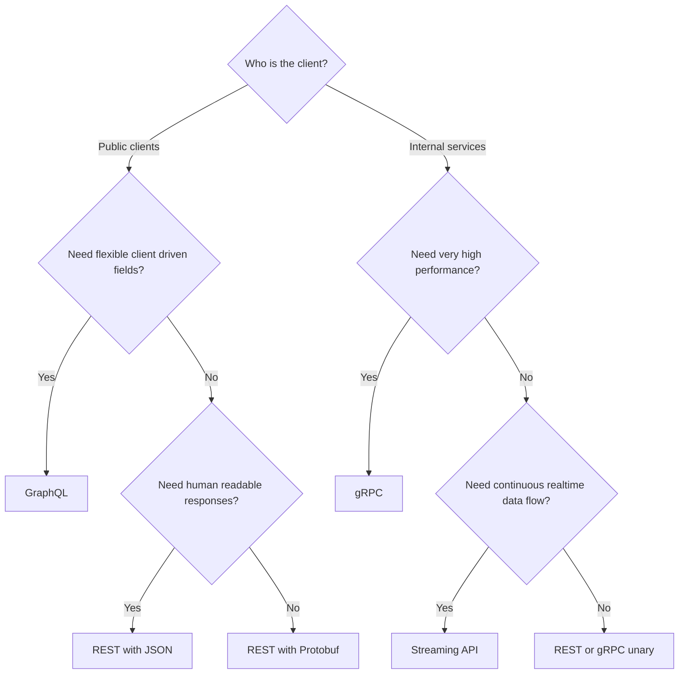
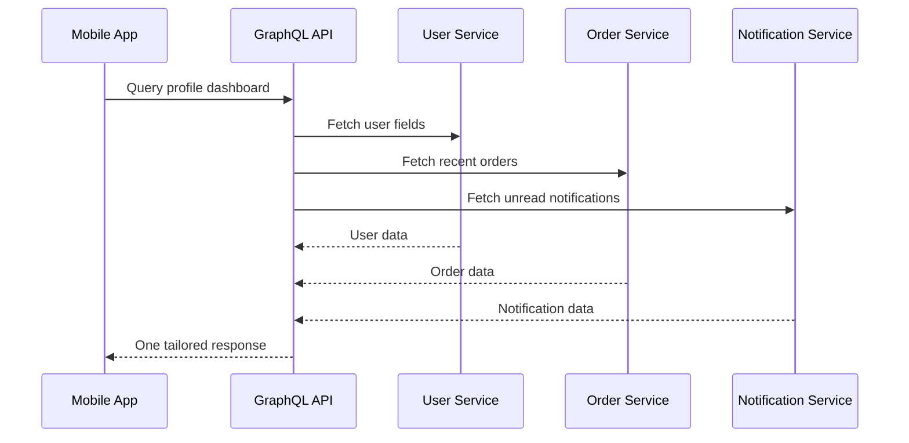
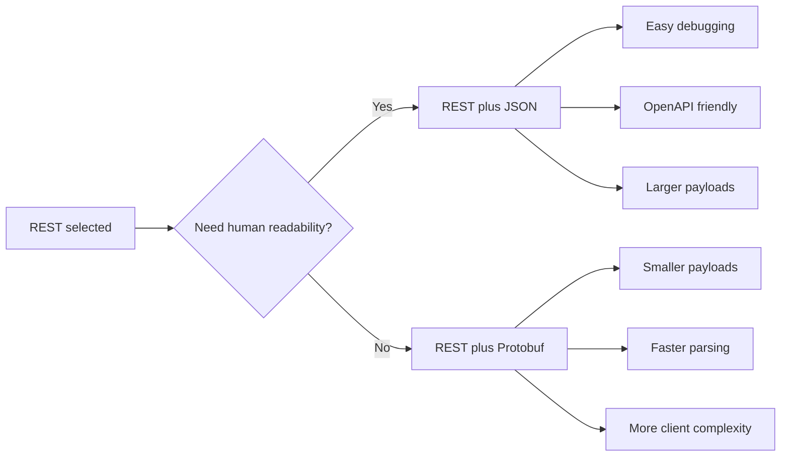
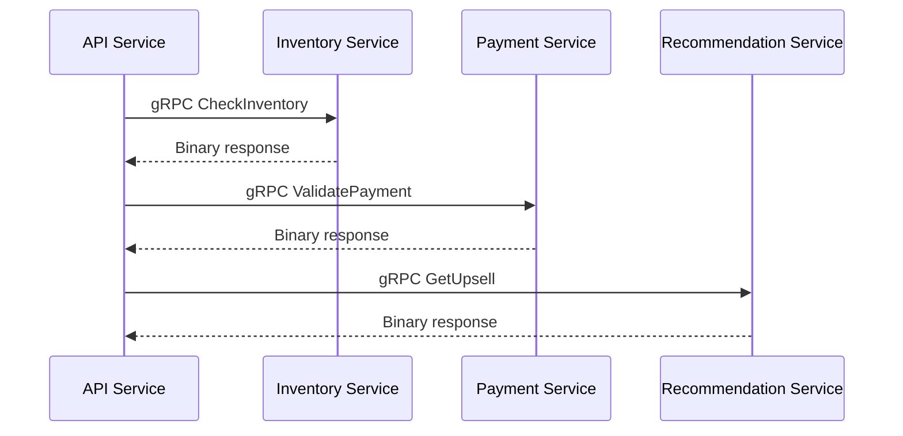
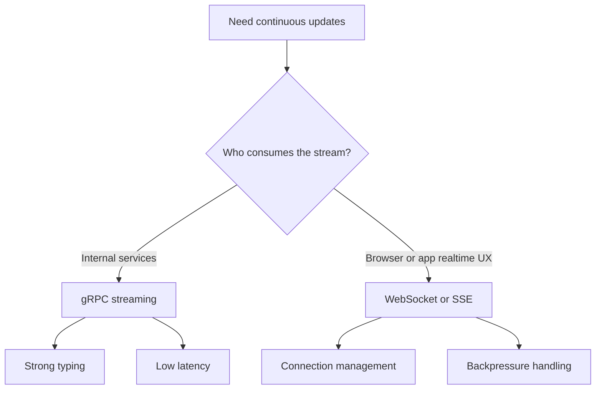

# Day 93 - Architect API Design Decision Tree
## How to Choose REST JSON, REST Protobuf, GraphQL, gRPC, or Streaming for Scalable Microservices

> **Series:** System Design Interview Preparation Series  
> **Difficulty:** Senior  
> **Core Concept:** API style selection by client type, flexibility need, performance, readability, and operational complexity  
> **Prerequisite:** Day 24 - API Protocol Decision Framework, Day 70 - Load Balancing Layers, Day 92 - Messaging System Decision Tree

---

## Why This Matters

One of the most common architecture questions in interviews is:

> **Which API design pattern would you use for a scalable microservice system, and why?**

Most developers know the names:
- REST
- GraphQL
- gRPC
- streaming APIs

But they struggle with the actual decision.

A senior architect does not choose by trend.  
A senior architect chooses by five factors:

1. **Client type** - public clients or internal services  
2. **Performance need** - latency, throughput, payload efficiency  
3. **Data flexibility** - fixed contract or client-selected fields  
4. **Readability** - human-readable responses or machine-efficient binary  
5. **Operational complexity** - schema design, monitoring, tooling, caching

---

## The Architect Decision Tree

---

## Step 1 - Start with Client Type

This is the first branching decision because external and internal APIs optimize for different things.

### Public client APIs
Examples:
- web apps
- mobile apps
- third-party developers
- partner integrations

Public APIs optimize for:
- compatibility,
- discoverability,
- documentation,
- debuggability,
- long-term contract stability.

### Internal service APIs
Examples:
- microservice to microservice communication,
- backend orchestration calls,
- high-frequency internal traffic.

Internal APIs optimize for:
- low latency,
- high throughput,
- strict schemas,
- machine efficiency,
- controlled ecosystem tooling.

---

## Step 2A - Public APIs: GraphQL or REST

If the client is public-facing, ask:

> **Do clients need response flexibility?**

If yes, choose **GraphQL**.  
If no, choose **REST**.

### When GraphQL is the right answer

Use GraphQL when:
- frontend screens need different shapes of the same data,
- mobile apps must avoid over-fetching,
- clients need to compose multiple resources in one request,
- frontend teams evolve faster than backend endpoints.

### Why architects like GraphQL

- client chooses fields at runtime,
- multiple related resources can be fetched in one query,
- reduces under-fetching and over-fetching,
- good for complex UI aggregation layers.

### GraphQL trade-offs

- higher learning curve,
- schema design discipline required,
- caching is harder than REST,
- query complexity control is mandatory,
- monitoring must understand field-level cost.

### When REST is the right answer

Use REST when:
- API is public and broadly consumed,
- resource model is stable,
- HTTP semantics matter,
- caching and CDN friendliness are important,
- operational simplicity is preferred.

REST remains the industry default because it is:
- widely understood,
- easy to debug,
- easy to document with OpenAPI,
- easy to operate across gateways and proxies.

---

## Step 2B - REST Response Format: JSON or Protobuf

Once REST is chosen, ask:

> **Should the response be human-readable or machine-efficient?**

### REST plus JSON

Choose **REST plus JSON** when:
- external developers need easy debugging,
- browser and tool compatibility matters,
- payload size is acceptable,
- public documentation and readability are priorities.

Strengths:
- human-readable,
- universally supported,
- great for public APIs and partner ecosystems.

Considerations:
- define versioning strategy,
- use proper HTTP status codes,
- publish OpenAPI documentation,
- manage payload bloat on large responses.

### REST plus Protobuf

Choose **REST plus Protobuf** when:
- clients still want REST-style semantics,
- but payload efficiency matters more than readability,
- parsing speed and wire size must improve.

Strengths:
- smaller payload size,
- faster parsing,
- better machine efficiency.

Trade-off:
- less human-friendly,
- weaker browser/debug ergonomics than JSON,
- client tooling must support binary payload handling.

---

## Step 3 - Internal Services: gRPC or Streaming

If the clients are internal services, ask:

> **Do we need very high performance?**

If yes, choose **gRPC**.

### Why gRPC is the architect choice for internal microservices

gRPC is strong when you need:
- low latency,
- high throughput,
- strict typing,
- contract-first APIs,
- multi-language service ecosystems,
- built-in unary and streaming patterns.

gRPC works especially well for:
- service meshes,
- internal platform APIs,
- recommendation engines,
- fraud checks,
- orchestration between hot path services.

### gRPC trade-offs

- more complex setup than REST,
- binary protocol is harder to inspect manually,
- teams must be comfortable with Protobuf contracts,
- observability and debugging need stronger tooling.

---

## Step 4 - When Streaming Becomes the Right Pattern

If ultra-high performance unary RPC is not the only concern, ask:

> **Do we need continuous realtime data flow?**

If yes, choose a **streaming API pattern**.

Streaming is right for:
- live dashboards,
- market feeds,
- telemetry pipelines,
- collaborative updates,
- incremental event delivery,
- server push use cases.

### Architecturally, what "streaming" means

Streaming is not just a transport detail.  
It changes:
- backpressure design,
- connection lifecycle,
- flow control,
- retry semantics,
- timeout model,
- observability strategy.

Possible choices include:
- gRPC streaming for internal services,
- WebSocket for bidirectional client interaction,
- SSE for simpler server-to-client event streams.

---

## The Senior Architect Comparison Table

| Style | Best for | Strength | Main cost |
|---|---|---|---|
| **REST plus JSON** | public APIs | simple, readable, standard | larger payloads |
| **REST plus Protobuf** | public or partner APIs needing efficiency | smaller payloads with REST semantics | lower readability |
| **GraphQL** | UI-heavy public clients | flexible field selection | caching and query complexity |
| **gRPC** | internal microservices | high throughput, low latency, strong typing | tooling and debugging complexity |
| **Streaming API** | realtime continuous delivery | live incremental flow | connection and backpressure complexity |

---

## Operational Checks Before Finalizing

Before locking the pattern, evaluate:

1. **Documentation**
   - OpenAPI for REST
   - schema registry and SDL discipline for GraphQL
   - Protobuf contract governance for gRPC

2. **Caching**
   - REST is easiest to cache through HTTP semantics
   - GraphQL requires deliberate caching strategy
   - gRPC caching is usually application-specific

3. **Observability**
   - request tracing,
   - payload cost,
   - latency percentiles,
   - error classification,
   - schema evolution visibility.

4. **Versioning and evolution**
   - REST needs URI or header versioning strategy,
   - GraphQL prefers additive evolution and deprecation,
   - gRPC depends on disciplined Protobuf compatibility rules.

---

## Common Mistakes

- Choosing GraphQL for simple CRUD APIs.
- Choosing REST JSON for ultra-hot internal service meshes.
- Choosing gRPC for public browser-facing APIs without ecosystem fit.
- Choosing streaming when polling or unary request-response is enough.
- Ignoring operational maturity while picking a technically correct protocol.

---

## Interview Ready Answer

I choose API design patterns through a decision tree. First I classify the client as public or internal. For public APIs, if clients need field-level flexibility and aggregated fetching, I use GraphQL; otherwise I use REST. If REST is selected, I choose JSON when readability and ecosystem compatibility matter, and Protobuf when wire efficiency matters more. For internal service-to-service communication, I prefer gRPC when low latency, high throughput, and strong typing are required. If the workload involves continuous realtime updates instead of simple request-response, I move to a streaming pattern such as gRPC streaming or WebSocket depending on the consumer type. The final choice is always validated against caching, schema evolution, observability, and operational complexity.

---

## One Line Takeaway

> **Choose APIs by client type first, then by flexibility, performance, readability, and operational cost.**

**Day 93/50 complete.**
