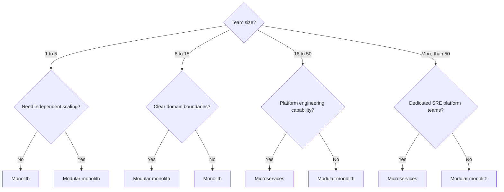
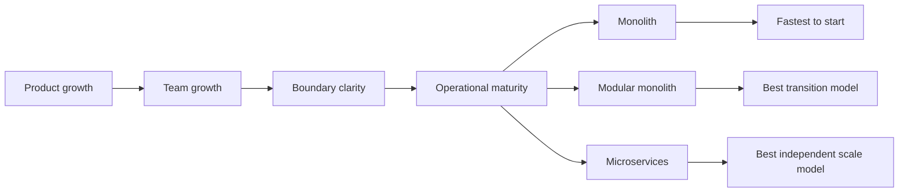
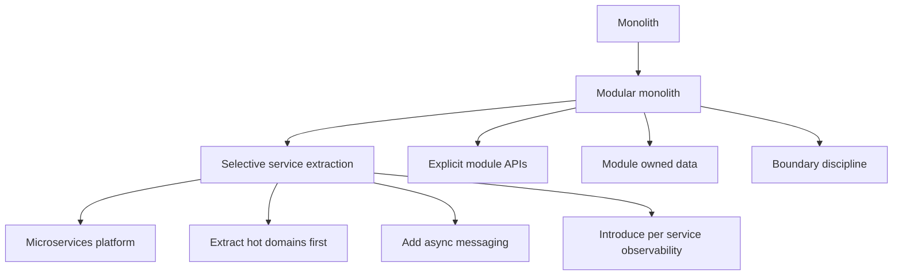

# Day 94 - Architecture Decision Tree: Monolith vs Modular Monolith vs Microservices
## How Architects Choose the Right System Shape Based on Team Size, Product Stage, and Platform Maturity

> **Series:** System Design Interview Preparation Series  
> **Difficulty:** Senior  
> **Core Concept:** architecture style selection by team size, scaling need, domain boundaries, and platform capability  
> **Prerequisite:** Day 40 - Modular Monolith Architecture, Day 83 - System Design Framework, Day 93 - API Design Decision Tree

---

## Why This Matters

When asked in an interview,

> **What architecture would you use for this system?**

many developers immediately answer:

> **Microservices.**

That is usually the wrong default.

Architecture is not chosen by fashion.  
It is chosen by:

1. **product size and maturity**
2. **team size**
3. **need for independent scaling**
4. **clarity of domain boundaries**
5. **platform and SRE maturity**

The architect decision is not “microservices or not.”  
It is **which level of decomposition the organization can actually operate successfully today**.

---

## The Architecture Decision Tree

---

## Step 1 - Small Teams: 1 to 5 Developers

For very small teams, the main question is:

> **Do different components truly need independent scaling?**

### If no
Choose a **monolith**.

Why:
- one codebase,
- one deployment unit,
- lower operational overhead,
- faster development loops,
- easier debugging and testing.

For small teams, simplicity beats distribution.

### If yes
Choose a **modular monolith**.

Why:
- still keeps deployment simple,
- introduces module boundaries early,
- prepares the codebase for future decomposition,
- supports growth without immediate distributed-systems overhead.

This is often the best answer for a growing startup.

---

## Step 2 - Mid-Sized Teams: 6 to 15 Developers

Now the question becomes:

> **Do we have clear domain boundaries?**

Examples of clear domains:
- user management,
- audit,
- payments,
- search,
- notifications.

### If boundaries are clear
Choose a **modular monolith**.

This gives:
- module ownership,
- cleaner interfaces,
- less coupling,
- future extraction path.

### If boundaries are not clear
Choose a **monolith**.

Because if the business boundaries are still fuzzy, microservice boundaries will be wrong too.

Bad service boundaries are harder to fix than bad package boundaries.

---

## Step 3 - Larger Teams: 16 to 50 Developers

At this stage, the question is no longer just code organization.

The key question is:

> **Do we have platform engineering capability?**

Meaning:
- CI and CD maturity,
- observability,
- centralized logging,
- tracing,
- service discovery,
- contract governance,
- deployment automation,
- incident management discipline.

### If yes
Choose **microservices**.

Because now the organization may actually support:
- independent deployments,
- service-level scaling,
- separate team ownership,
- isolated change velocity.

### If no
Choose **modular monolith**.

Without platform maturity, microservices become distributed confusion:
- too many repos,
- too many pipelines,
- too many outages,
- too little ownership clarity.

---

## Step 4 - Very Large Teams: More Than 50 Developers

For large organizations, the decision tilts more toward microservices, but not automatically.

The key question is:

> **Do we have dedicated SRE and platform teams?**

### If yes
Choose **microservices**.

This is where service-per-domain, team autonomy, and per-service scalability start to become operationally worthwhile.

### If no
Choose **modular monolith**.

Because a large team without platform support can still fail badly with microservices.

And at this scale:

> **A badly run microservice system is worse than a well-structured modular monolith.**

---

## Architecture Comparison Workflow

---

## What Each Choice Optimizes For

| Architecture | Best when | Strength | Cost |
|---|---|---|---|
| **Monolith** | small team, early product, low ops maturity | simplicity and speed | no independent scaling or deploys |
| **Modular monolith** | growing team, clear modules, future evolution | structure with low ops cost | still one deployment unit |
| **Microservices** | large team, strong platform, high scale variation | team autonomy and service-level scale | highest operational complexity |

---

## High-Level Transition Path

The most stable journey is rarely:

> monolith -> everything becomes microservices overnight

The healthier path is usually:

> monolith -> modular monolith -> selective extraction -> microservices where justified

---

## Senior Architect Interpretation

### Monolith

Best for:
- speed,
- early experimentation,
- tight transactional workflows,
- very small teams.

Wrong when:
- one subsystem needs radically different scaling,
- deployments must be independent,
- multiple teams constantly block each other.

### Modular monolith

Best for:
- growing products,
- clear internal domains,
- low ops maturity but rising complexity,
- future service extraction.

Wrong when:
- scale and release needs differ radically by domain,
- strong isolation is mandatory,
- multiple teams need full deployment independence today.

### Microservices

Best for:
- many independently owned domains,
- large teams,
- uneven scaling needs,
- mature platform engineering.

Wrong when:
- organization lacks service governance,
- observability is weak,
- release automation is immature,
- service boundaries are guessed instead of understood.

---

## Common Mistakes

1. **Starting with microservices too early**
   - complexity arrives before scale does.

2. **Keeping a tangled monolith too long**
   - module discipline should start before pain becomes severe.

3. **Calling a layered monolith a modular monolith**
   - modules need real ownership boundaries, not just folders.

4. **Extracting services before platform capability exists**
   - this creates operational drag, not architectural progress.

---

## Interview Ready Answer

I choose between monolith, modular monolith, and microservices using a team-and-operations decision tree. For teams of 1 to 5, I usually prefer a monolith unless independent scaling is already necessary, in which case I use a modular monolith. For teams of 6 to 15, the key decision is whether domain boundaries are clear; if yes, modular monolith is ideal, otherwise monolith remains safer. For teams of 16 to 50, microservices only make sense if platform engineering capability exists; otherwise a modular monolith is the better balance. For teams larger than 50, microservices become more attractive, but only if dedicated SRE and platform teams can support the operational model. My default growth path is monolith to modular monolith to selective microservice extraction, not microservices from day one.

---

## One Line Takeaway

> **Do not choose microservices because the system is important; choose them only when the organization is ready to operate them.**

**Day 94/50 complete.**
