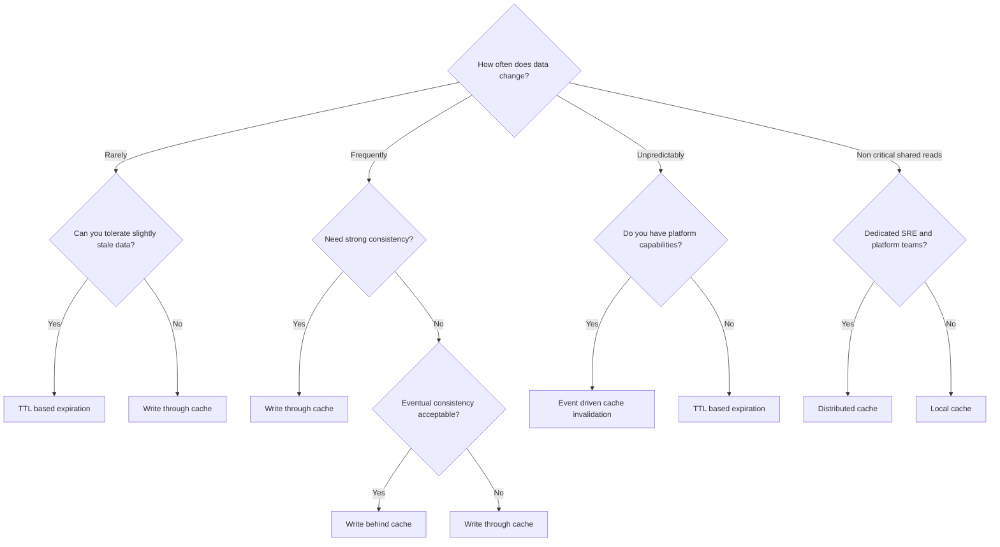
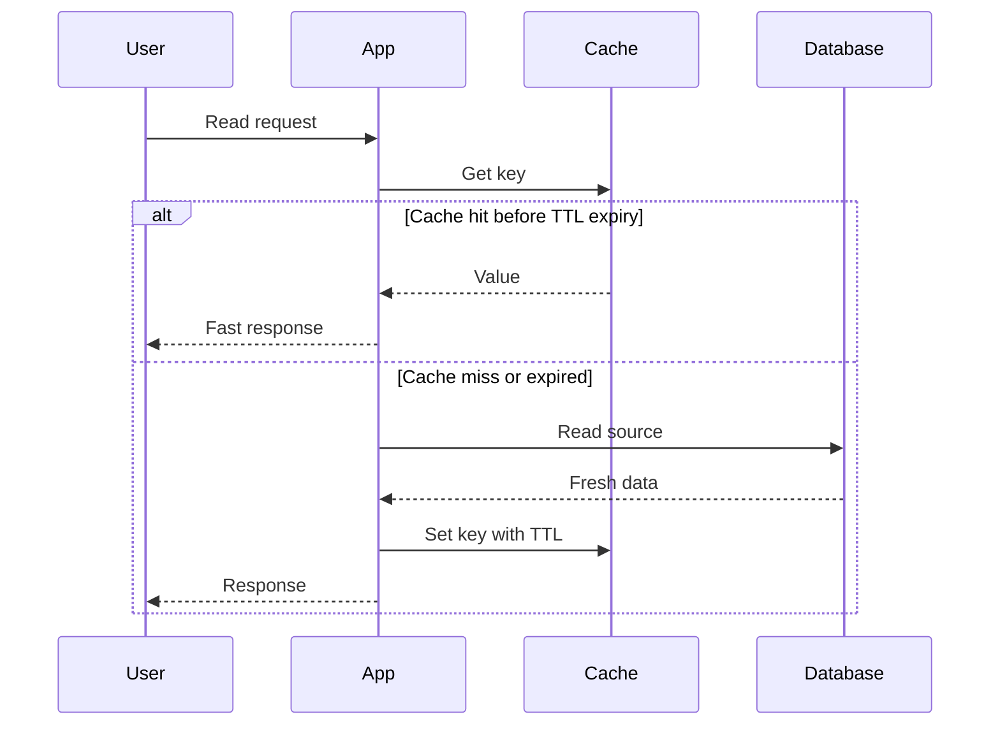
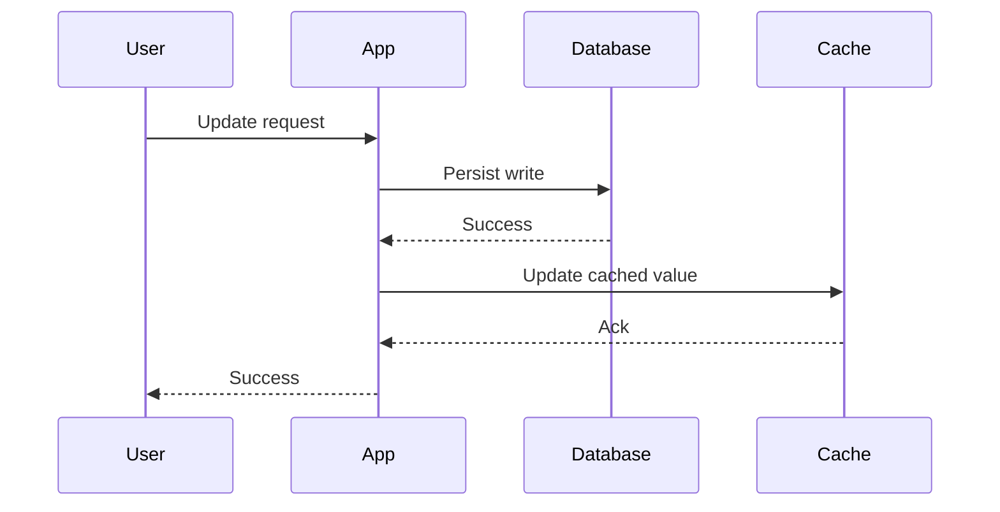

# Day 95 - Caching Strategy and Invalidation Decision Tree
## How Architects Choose TTL, Write Through, Write Behind, Event Driven Invalidation, Distributed Cache, or Local Cache

> **Series:** System Design Interview Preparation Series  
> **Difficulty:** Senior  
> **Core Concept:** cache invalidation strategy selection by data change rate, consistency need, staleness tolerance, and platform maturity  
> **Prerequisite:** Day 90 - Caching Decision Tree, Day 86 - Redis Building Blocks, Day 92 - Messaging System Decision Tree

---

## Why This Matters

The hardest part of caching is not adding the cache.

It is answering two questions correctly:

1. **How should this cache be updated or invalidated?**
2. **Where should this cache live?**

That is why developers get confused between:
- TTL based expiration
- write through cache
- write behind cache
- event driven invalidation
- distributed cache
- local cache

The architect decision is driven by:
- how often data changes,
- whether stale data is acceptable,
- how much consistency is required,
- whether the platform can support event driven invalidation,
- whether cache scope is local or shared.

---

## The Cache Strategy Decision Tree

---

## Step 1 - Rarely Changing Data

Examples:
- static reference data,
- country lists,
- lookup tables,
- configuration values,
- slow-moving catalogs.

Ask:

> **Can the system tolerate slightly stale data?**

### If yes
Choose **TTL based expiration**.

Why:
- simplest operational model,
- low maintenance,
- no write coupling,
- good fit for data that changes rarely.

Best for:
- CDN cached static content,
- application config,
- catalog snapshots,
- read heavy reference datasets.

### If no
Choose **write through cache**.

Why:
- cache is updated synchronously with writes,
- cache and database stay aligned,
- better for critical read paths where stale data is not acceptable.

---

## Step 2 - Frequently Changing Data

Examples:
- product details,
- user profiles,
- balances,
- inventory counts,
- business records that change regularly.

Ask:

> **Do you need strong consistency?**

### If yes
Choose **write through cache**.

Write through means:
1. write request arrives,
2. database is updated,
3. cache is updated in the same synchronous workflow,
4. reads observe fresh data quickly.

This is best for:
- critical data,
- low latency reads,
- moderate write volume,
- small to medium hot datasets.

### If no
Ask:

> **Is eventual consistency acceptable?**

If yes, choose **write behind cache**.

Write behind means:
1. write lands in cache first,
2. database update happens asynchronously later,
3. system gains write absorption capacity,
4. consistency becomes delayed.

Best for:
- non critical data,
- heavy write volumes,
- batched persistence,
- buffering workloads.

Trade-off:
- data loss risk if cache layer fails before flush,
- operational complexity is higher,
- not appropriate for strongly consistent workflows.

---

## Step 3 - Unpredictable or Real Time Change Patterns

Examples:
- realtime analytics,
- frequently mutating aggregates,
- rapidly changing event driven views,
- state derived from multiple producers.

Ask:

> **Do you have platform capabilities for eventing?**

### If yes
Choose **event driven cache invalidation**.

This means:
- updates emit events,
- subscribers invalidate or refresh cache keys,
- cache freshness follows business events instead of timers.

This is best when TTL is too blunt and change timing is irregular.

### If no
Choose **TTL based expiration**.

TTL is less precise, but it is operationally simpler than building a fragile half-evented system.

---

## Step 4 - Local Cache or Distributed Cache

This is a separate placement decision.

Ask:

> **Is the cache shared across many nodes and do you have platform support to run it well?**

### If yes
Choose **distributed cache**.

Examples:
- Redis cluster,
- Memcached fleet,
- shared cross-instance cache for sessions or common hot keys.

Best for:
- shared mutable state,
- multiple application nodes,
- centralized eviction and TTL policies.

### If no
Choose **local cache**.

Examples:
- Caffeine,
- Guava cache,
- in-process memory maps with eviction.

Best for:
- non critical data,
- per-node acceleration,
- small hot datasets,
- lower operational overhead.

---

## Workflow Diagrams

### TTL based expiration

### Write through cache

### Event driven invalidation

---

## Decision Table

| Situation | Best strategy | Why |
|---|---|---|
| Rarely changing and stale is acceptable | **TTL** | simplest and cheapest |
| Rarely changing but stale is not acceptable | **Write through** | keeps cache aligned with writes |
| Frequently changing and strong consistency needed | **Write through** | safer freshness model |
| Frequently changing and eventual consistency is acceptable | **Write behind** | absorbs high write volume |
| Unpredictable change timing with strong platform support | **Event driven invalidation** | precise freshness without short TTL churn |
| Shared hot data across many app nodes | **Distributed cache** | common state and centralized policy |
| Small per-node hot set without platform overhead | **Local cache** | fastest and simplest |

---

## Senior Architect Rules

1. **Prefer TTL when the business can tolerate imprecision.**
2. **Prefer write through when correctness matters more than write speed.**
3. **Use write behind only when business risk is clearly acceptable.**
4. **Use event driven invalidation only when platform maturity is real.**
5. **Pick local versus distributed cache based on sharing scope, not on habit.**

---

## Common Mistakes

1. **Using TTL for highly volatile critical data**
   - stale reads become production bugs.

2. **Using write behind for financial or inventory correctness**
   - asynchronous lag becomes data risk.

3. **Building event driven invalidation without reliable messaging**
   - missed events create long lived stale cache.

4. **Using distributed cache for tiny per-instance reference data**
   - unnecessary network hop and operational complexity.

---

## Interview Ready Answer

I choose caching strategy by starting with change frequency. If data changes rarely and slight staleness is acceptable, I use TTL expiration because it is simple and cheap. If stale data is not acceptable, I use write through cache so writes update both source and cache synchronously. For frequently changing data, strong consistency points to write through, while eventual consistency and high write volume may justify write behind for non critical workloads. If changes are unpredictable and the platform supports reliable events, I prefer event driven invalidation over aggressive TTLs. After invalidation strategy, I choose local or distributed cache based on whether the data is per-node or shared across the fleet.

---

## One Line Takeaway

> **Good cache design is not just where to cache, but how freshness is preserved when the source changes.**

**Day 95/50 complete.**
