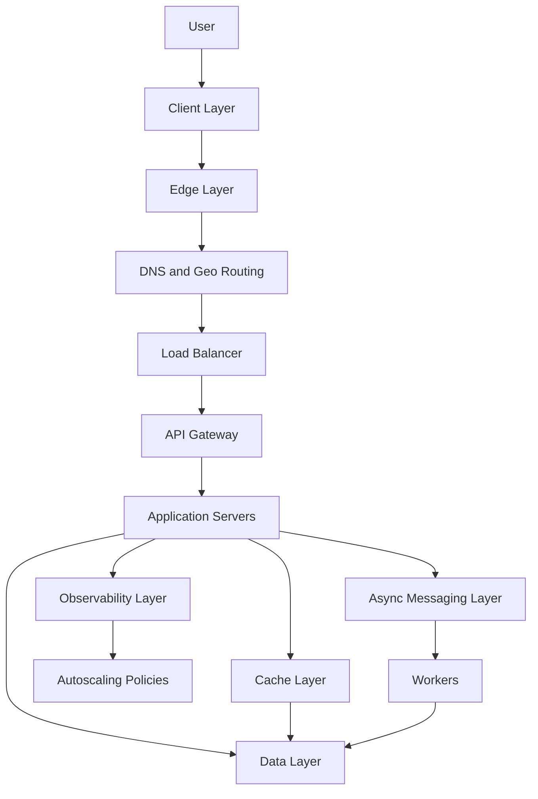
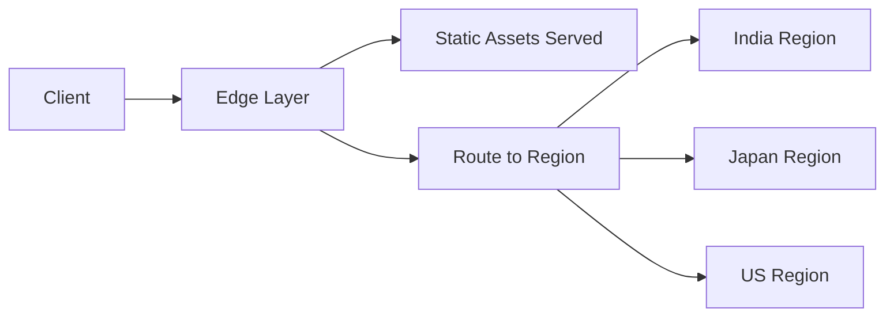
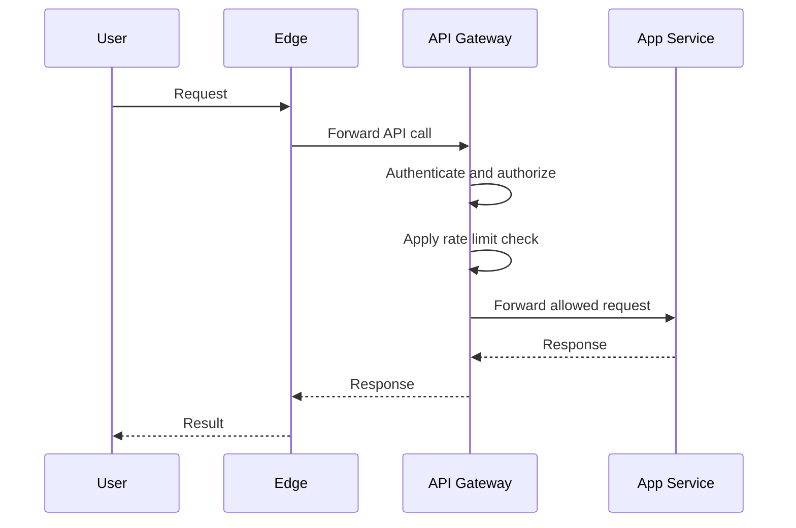
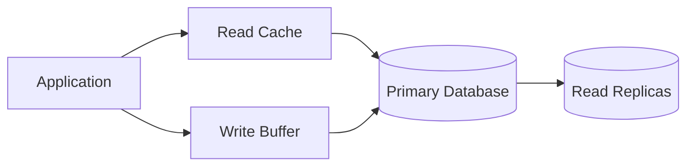
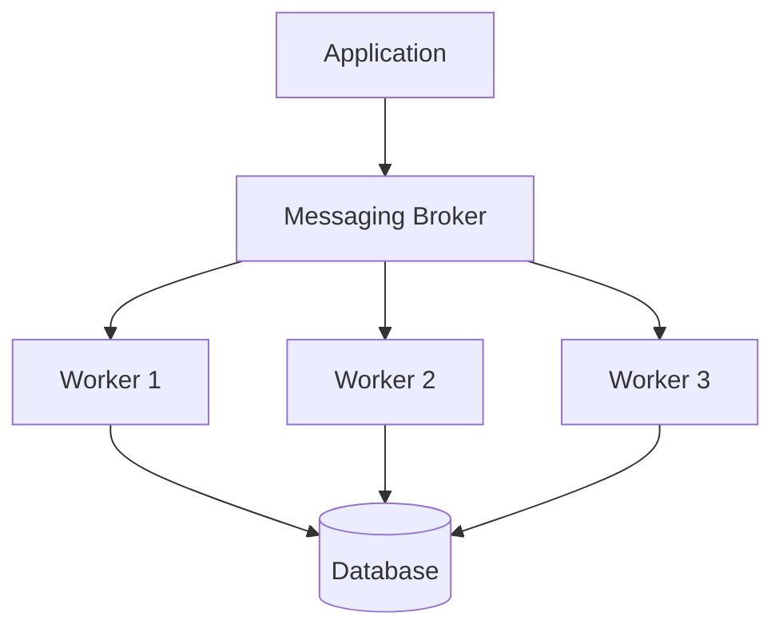
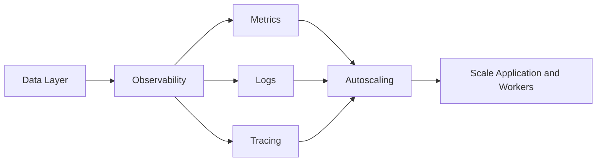

# Day 96 - The Seven Principles of Scalable Microservice Architecture
## How Google, Amazon, Microsoft, Netflix, and Meta Build Systems That Handle Millions of Requests Per Minute

> **Series:** System Design Interview Preparation Series  
> **Difficulty:** Senior  
> **Core Concept:** layered microservice architecture, stateless scaling, caching, async processing, observability, and autoscaling  
> **Prerequisite:** Day 83 - System Design Framework, Day 92 - Messaging System Decision Tree, Day 95 - Caching Strategy

---

## Why This Matters

When architects design a scalable microservice system, they do not start with one service and hope the rest emerges.

They design a **stack of responsibility layers**:
- client,
- edge,
- gateway,
- application,
- cache,
- async messaging,
- data,
- observability,
- autoscaling.

The point is not to create more boxes.  
The point is to make the system:
- scalable,
- modular,
- resilient,
- observable,
- and operationally manageable.

---

## The End-to-End Workflow

---

## Principle 1 - Start at the Client Layer

The system begins where the user interacts:
- mobile app,
- web browser,
- desktop app,
- partner client.

The client layer is responsible for:
- rendering the UI,
- initiating the request,
- handling retry/backoff behavior when appropriate,
- presenting cached or streamed data when possible.

This layer is not where business logic lives.  
It is where interaction begins.

---

## Principle 2 - Use the Edge Layer to Reduce Work Early

The edge layer is where architectures save the most cost for the least effort.

It handles:
- static asset delivery,
- DNS resolution,
- geo routing,
- CDN acceleration,
- region selection,
- first-line traffic steering.

The edge layer should prevent unnecessary origin calls whenever possible.

---

## Principle 3 - Put Authentication, Authorization, and Rate Limiting at the Gateway

After the edge, requests enter the **API gateway**.

The gateway is the right place for:
- authentication,
- authorization,
- rate limiting,
- request validation,
- routing to the correct downstream service.

This keeps application services focused on business behavior instead of cross-cutting concerns.

If a request fails at the gateway, the rest of the stack stays protected.

---

## Principle 4 - Keep Application Servers Stateless

Stateless application servers are the backbone of horizontal scaling.

If a server contains local business state, then scaling becomes harder because:
- requests must stick to one instance,
- failover becomes risky,
- deployments become more fragile.

Stateless app servers:
- can be replicated easily,
- can be autoscaled,
- can be replaced without data loss,
- keep the system elastic.

State should move to the right storage layer, not stay trapped in the process.

---

## Principle 5 - Add a Cache Layer for Speed

If the system is stateful or read-heavy, caching becomes essential.

Use cache when you need:
- faster reads,
- reduced database load,
- buffer for hot data,
- higher SLA performance.

Typical cache forms:
- read cache,
- write buffer,
- local cache,
- distributed cache.

The cache layer should be chosen based on:
- freshness requirement,
- data size,
- write frequency,
- sharing scope.

---

## Principle 6 - Make Async the Default for Offline Work

Not every action needs to complete inside the request thread.

For resilience and throughput, offload work to an async layer:
- event publishing,
- task queues,
- Kafka-like brokers,
- worker pools,
- background jobs.

This protects the main thread from getting blocked by:
- emails,
- report generation,
- media processing,
- notifications,
- audit writes,
- slow downstream systems.

Async design helps the system survive spikes and temporary downstream slowness.

---

## Principle 7 - Let Data, Observability, and Autoscaling Close the Loop

The final layer is where operational maturity shows up.

### Data layer
Use the right storage model:
- primary DB for source of truth,
- read replicas for scale,
- partitioning or sharding for growth,
- NoSQL when the access pattern fits,
- search engines for retrieval-heavy queries.

### Observability layer
Must include:
- logs,
- metrics,
- tracing,
- alerts.

### Autoscaling
Use observed signals to scale:
- CPU,
- memory,
- queue depth,
- request latency,
- replica lag,
- saturation.

Without observability, autoscaling is guessing.  
Without autoscaling, observability is just reporting failure faster.

---

## The Seven Principles Summary

| Principle | What it solves |
|---|---|
| Client layer | user interaction and request initiation |
| Edge layer | static delivery, geo routing, early reduction of load |
| Gateway layer | auth, authorization, and rate limiting |
| Stateless application | horizontal scaling and simpler failover |
| Cache layer | latency reduction and hot data acceleration |
| Async layer | resilience and background processing |
| Data + observability + autoscaling | durability, insight, and adaptive capacity |

---

## Senior Architect Mental Model

Think of the system as a funnel:

1. **Client** creates intent.
2. **Edge** removes unnecessary traffic.
3. **Gateway** decides whether the request is allowed.
4. **Application** executes business logic without storing session state.
5. **Cache** serves hot data quickly.
6. **Async** handles slow or offline work.
7. **Data** stores truth.
8. **Observability** measures reality.
9. **Autoscaling** reacts to load and health.

That is how million-request-per-minute systems stay manageable.

---

## Common Mistakes

1. Putting business logic in the gateway.
2. Keeping user session state inside app memory.
3. Skipping cache for read-heavy workloads.
4. Doing email, analytics, and file processing synchronously.
5. Ignoring observability until production breaks.
6. Scaling servers manually instead of defining policies.

---

## Interview Ready Answer

I design scalable microservice systems in layers. The client interacts through a client layer, then the edge layer handles static assets and geo routing. Requests that need server execution pass through a gateway that performs authentication, authorization, and rate limiting. Application servers remain stateless so they can scale horizontally. A cache layer handles hot reads and write buffering when needed. An async layer offloads offline work to queues and workers so main threads do not get blocked. The data layer uses the right storage mix, and observability plus autoscaling close the loop by measuring system health and automatically adapting capacity.

---

## One Line Takeaway

> **Scalable microservice architecture is not one box — it is a layered control system where each layer removes work, isolates state, and feeds the next.**

**Day 96/50 complete.**
