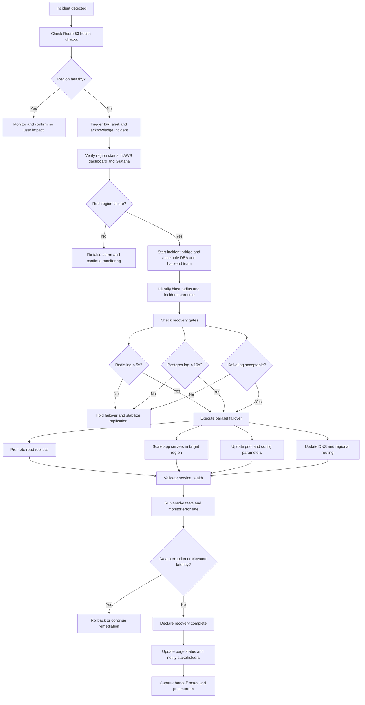
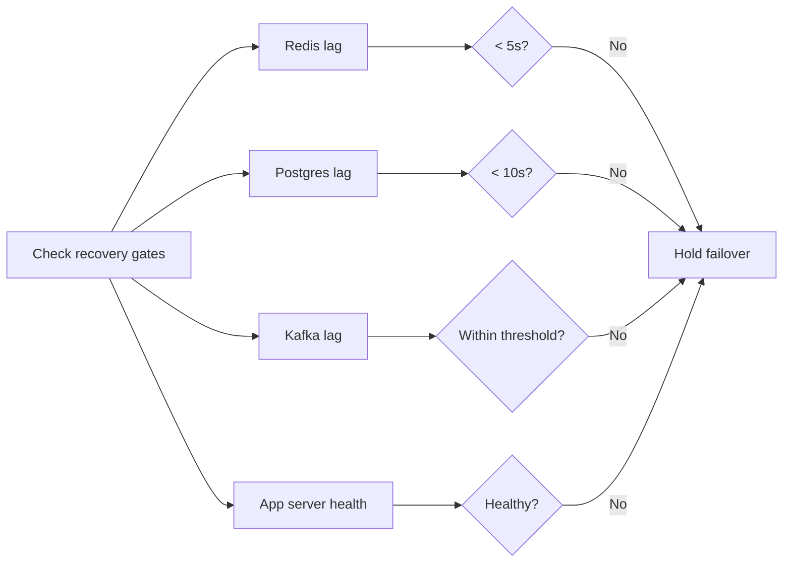
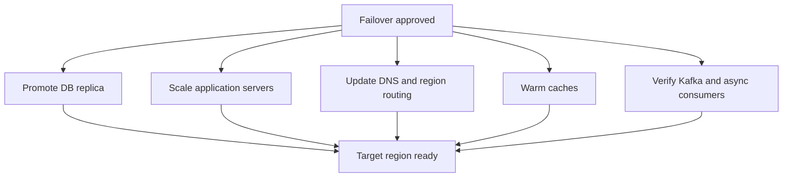
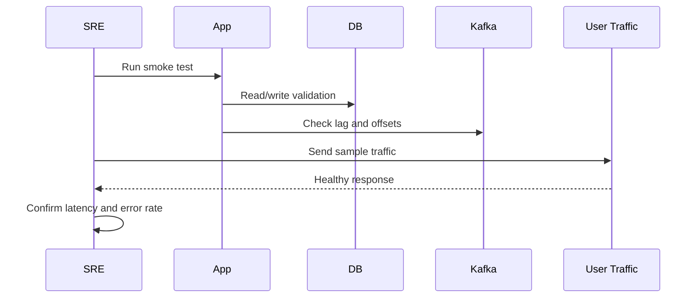
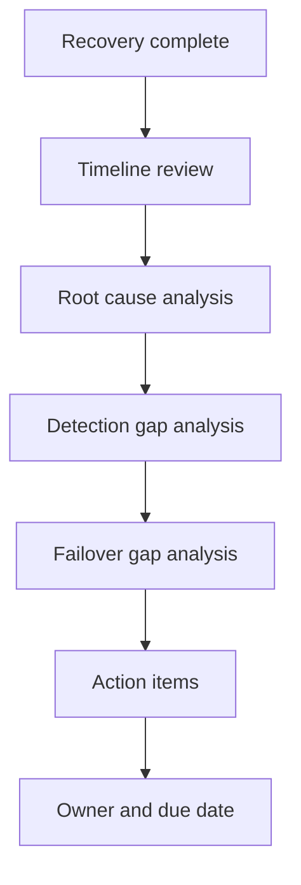

# Day 97 - Disaster Recovery Workflow for Regional Failover
## How to Detect, Triage, Validate, Recover, and Postmortem a Region-Wide Incident Without Breaking API Traffic

> **Series:** System Design Interview Preparation Series  
> **Difficulty:** Senior  
> **Core Concept:** disaster recovery workflow, regional failover, RTO/RPO, DNS cutover, database promotion, and validation gates  
> **Prerequisite:** Day 52 - Chaos Kong, Day 79 - Production Database Corruption, Day 96 - Scalable Microservice Architecture

---

## Why This Matters

When a region fails, the problem is not just infrastructure.

The architect must coordinate:
- detection,
- triage,
- blast-radius assessment,
- service validation,
- database promotion,
- cache recovery,
- traffic shifting,
- post-cutover verification,
- postmortem and learning.

The point of disaster recovery is not simply to "bring the system back."  
It is to restore service **without creating a second incident while recovering from the first**.

---

## The Disaster Recovery Workflow

---

## Step 1 - Detection

The first signal usually comes from:
- Route 53 health checks,
- synthetic probes,
- DRI alerts,
- error rate spikes,
- latency spikes,
- customer support escalations.

At this stage, the goal is to answer:

> **Is this a real regional outage, or a noisy alert?**

Checks:
- DNS health,
- ALB / gateway health,
- Grafana / AWS console,
- service health endpoints,
- region-level cloud status.

If it is not a real failure, do not trigger an unnecessary failover.

---

## Step 2 - Triage and Incident Command

If the region is truly unhealthy:

1. Open the incident bridge.
2. Assign a DRI.
3. Bring in:
   - backend lead,
   - DBA lead,
   - SRE/platform lead,
   - incident commander.
4. Record:
   - start time,
   - blast radius,
   - affected regions,
   - symptoms,
   - customer impact.

This prevents the failure from becoming unstructured chaos.

---

## Step 3 - Recovery Gates Before Failover

Before moving traffic, validate the state of critical dependencies.

Typical checks:
- Redis replication lag < 5 seconds,
- Postgres replication lag < 10 seconds,
- Kafka consumer lag within agreed threshold,
- application servers healthy in target region,
- caches warmed enough for acceptable SLA,
- no schema drift or un-applied migrations.

If the gates are not satisfied, failover can make the situation worse.

---

## Step 4 - Parallel Failover

Failover should not be a one-person guess.

This is usually a coordinated action between:
- DRI / incident commander,
- DB lead,
- SRE/platform lead,
- application owner.

### What gets done in parallel

1. **Database**
   - promote read replica or cross-region standby,
   - update DB connection targets,
   - confirm writes are landing in the new primary.

2. **Application**
   - scale instances in the target region,
   - update environment/config values,
   - adjust connection pool sizes,
   - warm critical caches.

3. **Traffic**
   - shift DNS / Route 53 records,
   - update region-based routing,
   - validate failover health checks.

---

## Step 5 - Validate Recovery

Do not declare success immediately after shifting traffic.

Run:
- synthetic API calls,
- read/write smoke tests,
- payment / critical workflow checks,
- cache-hit validation,
- Kafka lag validation,
- data integrity checks,
- latency and error-rate monitoring.

The system is recovered only when:
- customer-facing endpoints respond normally,
- data is not corrupted,
- replication is stable,
- operational alarms are back to baseline.

---

## Step 6 - Declare Recovery and Communicate

Once validation passes:
- update incident page status,
- notify stakeholders,
- publish recovery time,
- record residual risks,
- preserve timeline notes.

This is important because recovery is not complete until the organization knows what happened.

---

## Step 7 - Postmortem

The postmortem should answer:
- what failed,
- why detection took the time it did,
- whether failover gates were correct,
- whether traffic shift was safe,
- whether the region can be restored cleanly,
- what action items prevent recurrence.

---

## Senior Architect Checklist

| Phase | Question |
|---|---|
| Detection | Is this a real regional failure? |
| Triage | Who owns the incident and blast radius? |
| Gates | Are replication lag and service health acceptable? |
| Failover | Can DB, app, DNS, and cache switch in parallel? |
| Validation | Are smoke tests and metrics clean after shift? |
| Recovery | Has the incident been communicated and closed? |
| Postmortem | What must change to avoid repeating it? |

---

## Common Mistakes

1. Failing traffic before validating DB lag.
2. Promoting a replica without checking application config.
3. Updating DNS before target-region capacity is ready.
4. Ignoring cache warmup and then calling it recovery.
5. Declaring success before smoke tests complete.
6. Skipping the postmortem because "we fixed it."

---

## Interview Ready Answer

For regional disaster recovery, I use a structured workflow: detection, triage, gating, parallel failover, validation, recovery, and postmortem. First I confirm it is a real region failure through Route 53 health checks and dashboard telemetry. Then I open the incident bridge, identify blast radius, and check recovery gates such as Redis lag, Postgres lag, Kafka lag, and application health. If the gates are acceptable, I execute failover in parallel by promoting replicas, scaling target-region services, warming caches, and updating DNS or regional routing. After traffic shifts, I run smoke tests, monitor latency and errors, verify data integrity, and only then declare recovery. Finally I publish the incident timeline and postmortem with action items.

---

## One Line Takeaway

> **Disaster recovery is not just failover — it is a controlled sequence of detection, validation, traffic movement, and proof that the system is stable again.**

**Day 97/50 complete.**
