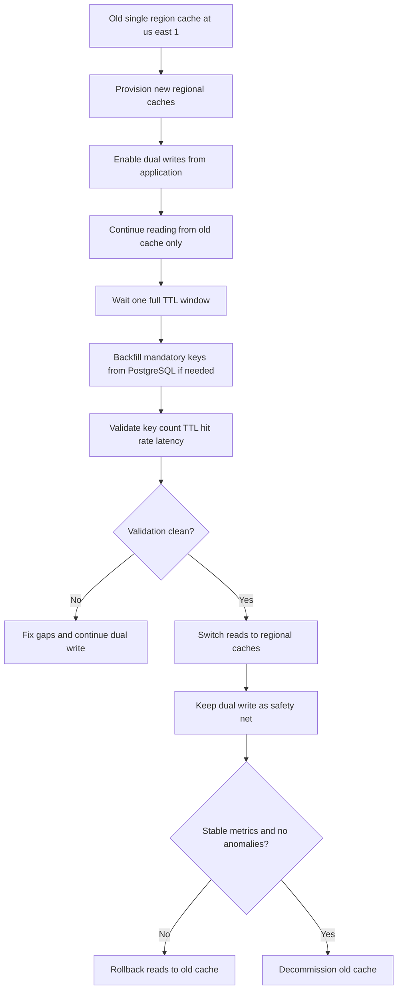
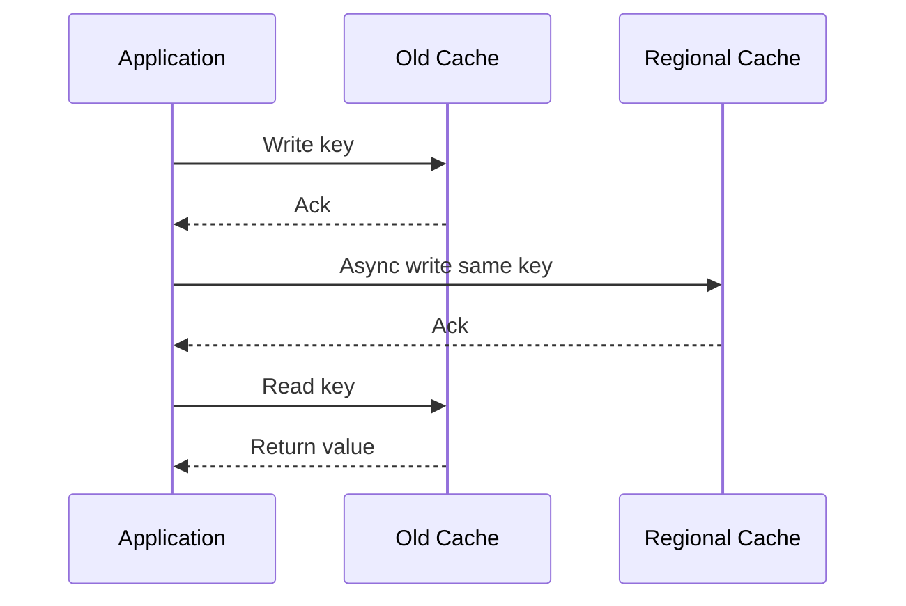
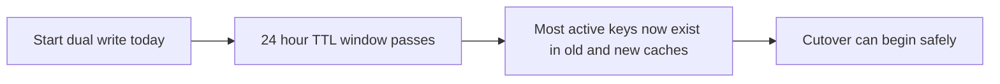
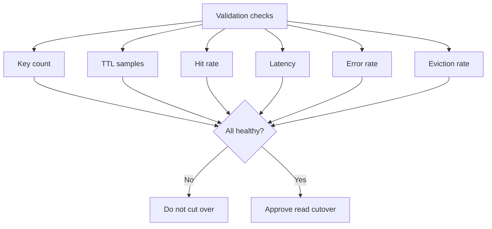

# Day 98 - Single Region to Multi Region Cache Migration Without Downtime
## How Architects Move from One Redis Cache to Regional Caches Without Losing Data or Breaking Live Traffic

> **Series:** System Design Interview Preparation Series  
> **Difficulty:** Senior  
> **Core Concept:** zero-downtime cache migration, dual write rollout, TTL soak period, cutover validation, rollback safety  
> **Prerequisite:** Day 95 - Caching Strategy and Invalidation Decision Tree, Day 97 - Disaster Recovery Workflow, Day 96 - Scalable Microservice Architecture

---

## Why This Matters

Imagine an e-commerce platform deployed globally.

Today:
- all regions use one common Redis cache,
- payment or session related hot data is stored there,
- traffic has grown,
- cache memory and throughput are at peak,
- vertical scaling is no longer enough.

Now you must migrate from:

> **one shared single-region cache**

to:

> **multiple regional caches**

The challenge is not creating three new Redis clusters.  
The challenge is migrating **without downtime**, **without data loss**, and **without disrupting in-flight traffic**.

---

## The Migration Goal

Start from:
- one old cache in `us-east-1`

Move to:
- one cache for `US`
- one cache for `Europe`
- one cache for `Japan`

And do it while:
- old traffic continues normally,
- applications still read from the old cache,
- new caches are filled in parallel,
- validation proves readiness before cutover,
- rollback stays possible.

---

## The Architect Migration Strategy

The cleanest rollout is:

1. **Provision new regional caches**
2. **Introduce dual writes**
3. **Keep reads on old cache**
4. **Wait for one full TTL window**
5. **Backfill must-have keys from source of truth**
6. **Validate key count, hit rate, latency, TTL samples**
7. **Cut reads over to new regional caches**
8. **Keep dual write temporarily as rollback safety**
9. **Decommission old cache only after stability**

---

## End to End Workflow

---

## Step 1 - Provision Regional Caches First

Do not touch the live read path first.

Create:
- `cache-us`
- `cache-eu`
- `cache-jp`

Each should have:
- separate endpoint,
- independent capacity,
- monitoring,
- eviction policy validation,
- network access from the correct region,
- consistent serialization format with the old cache.

The new clusters must be production ready before any application write reaches them.

---

## Step 2 - Dual Write Without Changing Reads

This is the safest migration move.

The application still reads from the **old cache**.

But on every write, it writes to:
- old cache,
- new regional cache for that user or region.

This gives you:
- zero user-visible behavior change,
- time to hydrate the new caches,
- a controlled way to compare old and new systems.

### Why keep reads on the old cache?

Because the live path remains stable while the new caches warm up.

Architecturally, this avoids turning migration into a customer-facing experiment.

---

## Step 3 - Wait for One Full TTL Window

If your cache TTL is `24 hours`, dual write must continue for **at least 24 hours** before cutover.

Why?

Because any key that is naturally updated during that TTL window will now exist in:
- the old cache,
- the new regional cache.

This means the active working set gets hydrated through normal traffic.

This is the key idea:

> **Use normal production traffic to hydrate the new caches before you switch reads.**

---

## Step 4 - Backfill Keys That Must Always Exist

Some keys cannot rely only on natural traffic.

Examples:
- critical payment context,
- fraud model seeds,
- cart recovery data,
- high-value session metadata,
- must-hit reference keys.

For those:
- read from PostgreSQL or source of truth,
- compute the same cache key,
- preload into the new regional caches,
- preserve TTL policy intentionally.

This is not a full database dump into Redis.

It is a **selective warmup** of critical keys that must be present before cutover.

---

## Step 5 - Validate Before Cutover

Do not switch because "24 hours passed."

Switch only when validation says the new caches are ready.

Key checks:

1. **Key count comparison**
   - compare old cache vs new regional caches for expected segments

2. **TTL sample comparison**
   - compare sampled keys and remaining TTL shape

3. **Hit rate**
   - target cache hit ratio must be close to expected baseline

4. **Latency**
   - regional cache latency should be healthy and lower or comparable

5. **Error rate**
   - timeout, write failure, deserialization mismatch, connection exhaustion

6. **Eviction behavior**
   - watch memory pressure and eviction spikes before routing reads

---

## Step 6 - Cut Over Reads to the New Regional Caches

Once validation is clean:
- update read routing,
- point `US` application traffic to `cache-us`,
- point `EU` traffic to `cache-eu`,
- point `JP` traffic to `cache-jp`.

At this point:
- reads use the new caches,
- dual write remains enabled,
- old cache becomes rollback support.

This is the correct sequence:

> **Write to both first, read from old first, then switch reads later.**

Not the other way around.

---

## Step 7 - Keep Dual Write as a Safety Net

After cutover, do **not** immediately shut off the old cache.

Keep dual write enabled for a short stabilization window.

This protects you if:
- read latency spikes,
- hit rate collapses,
- one region has hidden capacity issues,
- serialization mismatch appears under real traffic,
- eviction rate is worse than expected.

During this phase, rollback remains simple:
- redirect reads back to old cache,
- keep writes unchanged,
- investigate safely.

---

## Step 8 - Decommission the Old Cache Only After Stability

Decommission only when:
- latency is stable,
- hit rate is healthy,
- error rate is clean,
- eviction is under control,
- no anomalies are observed,
- rollback window is no longer needed.

At that point:
- disable dual write,
- remove old cache endpoint from config,
- decommission the old Redis cluster,
- update runbooks and diagrams.

---

## The Senior Architect Mental Model

This migration is not really about Redis.

It is about **separating write migration from read migration**.

That separation is what makes the system safe:

1. **Writes** begin populating the future state.
2. **Reads** stay on the known-good path.
3. **Time plus TTL** lets the live working set converge.
4. **Validation** proves the new system is ready.
5. **Cutover** happens only after proof.
6. **Rollback** remains possible because old infrastructure is still fed.

---

## Common Mistakes

1. Switching reads immediately after creating the new caches.
2. Disabling the old cache too early.
3. Ignoring TTL mismatch during migration validation.
4. Backfilling everything instead of only critical keys.
5. Forgetting region-specific routing logic in the application tier.
6. Running dual write synchronously and hurting user latency.

---

## Decision Table

| Phase | Primary action | Why |
|---|---|---|
| Provision | create regional caches | establish target topology safely |
| Hydrate | dual write while reading old cache | fill new caches without user impact |
| Soak | wait one full TTL window | let active keys naturally converge |
| Backfill | preload must-have keys | cover keys traffic may not touch |
| Validate | compare count TTL hit rate latency | prove readiness |
| Cutover | switch reads to new caches | activate regional topology |
| Stabilize | keep dual write temporarily | preserve rollback path |
| Retire | decommission old cache | finish migration cleanly |

---

## Interview Ready Answer

I would treat this as a no-downtime cache migration and use a dual-write, delayed-read-cutover strategy. First I provision regional caches for US, Europe, and Japan. Then I update the application so writes go to both the old cache and the new regional cache, but reads still come only from the old cache. If the cache TTL is 24 hours, I keep dual write for at least one full TTL window so the active working set naturally appears in both places. For keys that must always exist, I backfill selectively from PostgreSQL. Before switching reads, I validate key counts, TTL samples, hit rate, latency, eviction, and error rate. Once healthy, I cut reads over to the new regional caches but keep dual write for a rollback window. Only after stable metrics do I decommission the old cache.

---

## One Line Takeaway

> **Safe cache migration means writing to the future first, reading from the past until the future is proven ready, and only then switching the read path.**

**Day 98/50 complete.**
