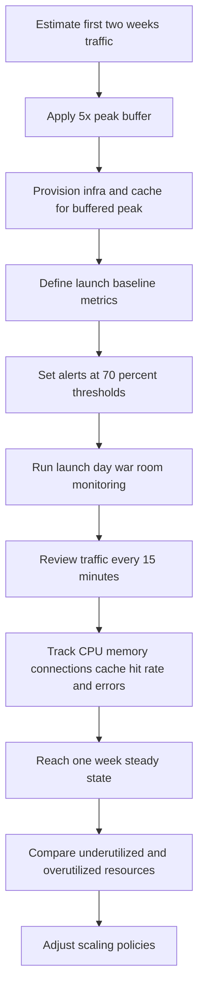
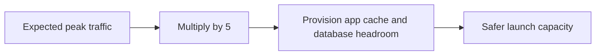
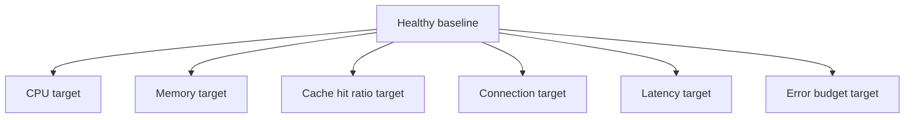
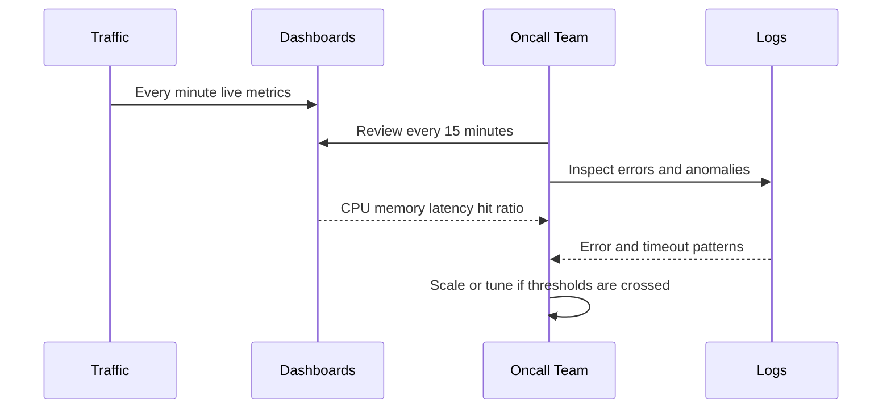

# Day 99 - Launch Scaling Strategy from Zero to Millions
## How Architects Prepare a Startup System to Survive a Traffic Surge Without Collapsing

> **Series:** System Design Interview Preparation Series  
> **Difficulty:** Senior  
> **Core Concept:** launch capacity planning, traffic buffers, baseline metrics, alert thresholds, launch-day monitoring, and post-launch scaling correction  
> **Prerequisite:** Day 83 - System Design Framework, Day 96 - Scalable Microservice Architecture, Day 97 - Disaster Recovery Workflow

---

## Why This Matters

This is a classic startup failure story:

1. a feature is launched,
2. traffic surges,
3. infrastructure was sized for hope instead of numbers,
4. the whole system collapses.

Architects avoid this by treating launch as a controlled scaling event, not a marketing surprise.

The goal is not only to survive launch traffic.  
The goal is to survive it while maintaining:
- low latency,
- high cache hit ratio,
- healthy CPU and memory headroom,
- strong availability,
- predictable recovery options.

---

## Example Launch Targets

Assume the product goals are:
- **10 million requests per second** peak design target,
- **less than 5 ms latency** for hot paths,
- **90 percent cache hit ratio**,
- **high availability** with no visible disruption.

Whether the exact number is realistic or not, the architect workflow is the same:
- estimate demand,
- add safety margin,
- define operational baselines,
- configure alerts,
- watch the system during launch,
- adjust after steady state emerges.

---

## The Launch Scaling Workflow

---

## Step 1 - Estimate Traffic for the First Two Weeks

The first architect question is:

> **What traffic do we expect in the first two weeks, and what can realistically spike above that?**

Do not size for average traffic.

Estimate:
- average QPS,
- peak QPS,
- read write ratio,
- active user concurrency,
- cacheable fraction of requests,
- connection growth to DB and cache,
- expected burst events from ads, notifications, or launch campaigns.

The input model should come from:
- product forecast,
- historical launches,
- marketing commitments,
- capacity of upstream and downstream dependencies.

---

## Step 2 - Apply a 5x Buffer

The next principle is simple:

> **Never launch at expected peak alone.**

If you expect peak load `X`, provision for at least **5X** during launch preparation when the business risk of outage is high.

Why:
- traffic forecasts are usually optimistic,
- retries amplify request volume,
- cold caches can multiply backend load,
- social virality is not linear,
- one hot feature can dominate request patterns.

This does not mean wasting money forever.  
It means buying survivability during the highest uncertainty window.

---

## Step 3 - Size the Cache and Infrastructure Around Peak, Not Hope

Cache must be able to absorb the hot working set under peak conditions.

If the target hit ratio is **90 percent**, capacity planning must ensure:
- enough memory for hot keys,
- acceptable eviction rate,
- regional or shard sizing for throughput,
- connection capacity from applications,
- warmup strategy for hot objects.

Also size:
- application server count,
- DB primary write headroom,
- read replica capacity,
- connection pools,
- queue consumers,
- autoscaling ceilings.

If cache is undersized, the miss storm shifts pain to the database and the launch can fail even if app servers look healthy.

---

## Step 4 - Define Baseline Operating Metrics

Before launch day, define what "healthy" means.

Example baseline dimensions:
- CPU utilization,
- memory usage,
- cache hit ratio,
- database connections,
- request latency,
- error rate,
- queue lag,
- replica lag.

These baselines are the reference line for live operations.

Without a baseline, an architect cannot distinguish:
- acceptable variance,
- early warning,
- actual failure onset.

---

## Step 5 - Configure Alerts Before the Launch, Not During It

A useful launch rule is:

> **Warn at 70 percent, do not wait for 95 percent.**

Good examples:
- CPU warning at **70 percent**
- memory warning at **70 percent**
- DB connection warning at **70 percent**
- cache memory warning at **70 percent**
- cache hit ratio alert when it drops below target

Why 70 percent matters:
- it preserves reaction time,
- it gives autoscaling space,
- it avoids panic tuning under hard saturation,
- it catches trend direction before the cliff.

Architects set alerts on:
- leading indicators,
- not only final failures.

---

## Step 6 - Launch Day War Room

On launch day, do not just "watch dashboards."

Run an operational rhythm:
- review metrics every **15 minutes**,
- compare traffic against forecast,
- track deviation from baseline,
- keep engineering on standby,
- inspect Splunk or logging tools continuously for emerging patterns.

The launch war room should answer:
- Is traffic higher or lower than forecast?
- Is cache hit ratio holding?
- Are connections rising too quickly?
- Are p95 or p99 latencies drifting?
- Are specific APIs or tenants driving the spike?

---

## Step 7 - Reach Steady State After One Week

After roughly one week, traffic often becomes more predictable.

Now the architect moves from **launch safety mode** to **cost-correctness mode**.

Check:
- which services are underutilized,
- which are still near saturation,
- whether cache memory is excessive or insufficient,
- whether autoscaling thresholds are too aggressive or too conservative,
- whether connection pools are oversized or undersized.

This is where you refine the system:
- lower waste where safe,
- raise ceilings where needed,
- tune scaling policies using observed traffic instead of forecasts.

---

## The Architect Mental Model

Launch scaling is a three-phase process:

1. **Before launch**
   - estimate,
   - overprovision,
   - define baselines,
   - set alerts.

2. **During launch**
   - monitor frequently,
   - compare to forecast,
   - watch leading indicators,
   - react before saturation.

3. **After launch**
   - study steady state,
   - optimize resource allocation,
   - adjust scaling policy permanently.

That is how systems go from zero traffic to millions without collapsing.

---

## Common Mistakes

1. Planning for average load instead of launch spikes.
2. Launching without a buffer.
3. Setting alerts too late near saturation.
4. Watching only CPU and ignoring cache hit ratio or connection growth.
5. Scaling app servers but forgetting the database and cache path.
6. Keeping launch overprovisioning forever without steady-state correction.

---

## Decision Table

| Phase | Primary action | Why |
|---|---|---|
| Forecast | estimate first two weeks traffic | understand expected load envelope |
| Buffer | add 5x headroom | absorb forecast error and surge amplification |
| Baseline | define healthy CPU memory latency connections hit ratio | create measurable operating targets |
| Alerting | warn at 70 percent | act before saturation |
| Launch ops | review every 15 minutes | catch deviations early |
| Steady state | tune after one week | move from safety provisioning to efficient scaling |

---

## Interview Ready Answer

For a launch that may scale from zero to millions of requests, I use a launch scaling strategy with three phases. Before launch, I estimate the first two weeks of traffic and provision for at least five times expected peak so the system has headroom during uncertainty. I size cache, app, and database tiers to preserve latency and cache hit targets, then define health baselines for CPU, memory, connections, latency, and hit ratio. I set warning alerts around 70 percent utilization so the team can react before saturation. On launch day, I run a war room with 15-minute metric reviews and active log monitoring to compare real traffic against forecast. After about a week, once traffic reaches steady state, I tune scaling policies based on actual underutilization and overutilization patterns.

---

## One Line Takeaway

> **Launch reliability is not luck; it is forecast, buffer, baseline, alerting, and disciplined monitoring before the first spike arrives.**

**Day 99/50 complete.**
